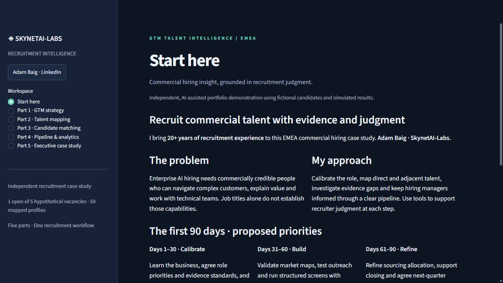

# Anthropic GTM Talent Intelligence

An independent recruitment case study by **Adam Baig / SkynetAI-Labs**, applying 20+ years of recruitment experience to an EMEA commercial hiring challenge. No affiliation with or endorsement by Anthropic.

## Explore the case study

The application connects market strategy, talent mapping, transparent assessment and recruitment operations. All candidate records and performance figures are fictional. Recruiters retain responsibility for decisions.

- **Part 1:** [GTM recruitment strategy](docs/lab-01-gtm-strategy/README.md), with detailed [research notes](docs/lab-01-gtm-strategy/research-notes.md).
- **Part 2:** 50 searchable talent profiles across direct and adjacent sectors.
- **Part 3:** Explainable scoring, evidence gaps and role-specific screening questions.
- **Part 4:** Pipeline review and analytics in one workspace.
- **Part 5:** [Executive case study and first 90 days](docs/lab-05-executive-case-study/README.md).



The simulated portfolio has 50 mapped prospects, 30 applications and five single-seat searches. Six offers produce four acceptances, one decline and one pending decision. The public entry point gives each visitor a separate demo pipeline.

[Executive presentation](presentation/executive-case-study.pptx) · [Walkthrough script](docs/walkthrough-script.md) · [Verification record](docs/verification.md)

## Run locally

Python 3.12:

```powershell
python -m venv .venv
.\.venv\Scripts\python -m pip install -r requirements.txt
.\.venv\Scripts\python -m streamlit run streamlit_app.py
```

Use `app/dashboard.py` as the entry point for local SQLite persistence. The public `streamlit_app.py` entry point keeps edits within the current visitor session. No API key is required.

Run tests with `python -m pytest -q`. The latest local run passed **33 tests**, including independent visitor sessions. [Technical assessment limits](docs/lab-03-candidate-matching/README.md) explain the illustrative rules and calibration needs.

## Architecture and responsible use

Streamlit, Python, Pandas and SQLite. Matching follows documented deterministic rules. No language model service processes candidate records. Scores support human screening and have not been validated for live hiring.

## Contact

[Adam Baig on LinkedIn](https://www.linkedin.com/in/adambaiguk) · [SkynetAI-Labs on GitHub](https://github.com/SkynetAI-Labs)
